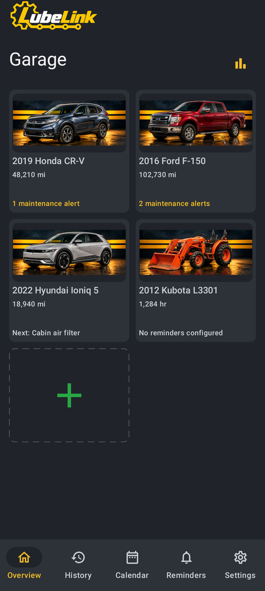
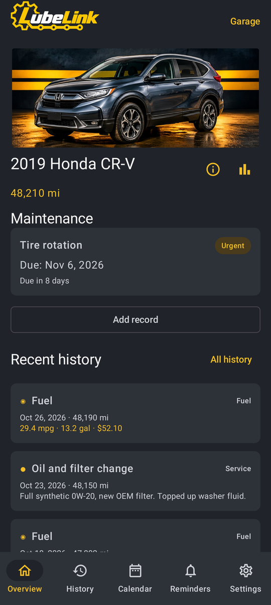
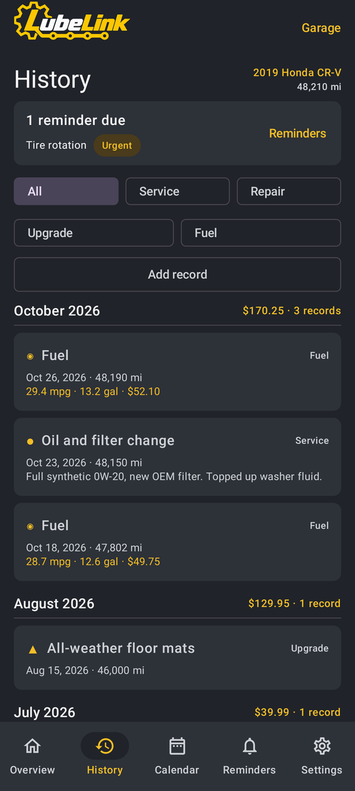
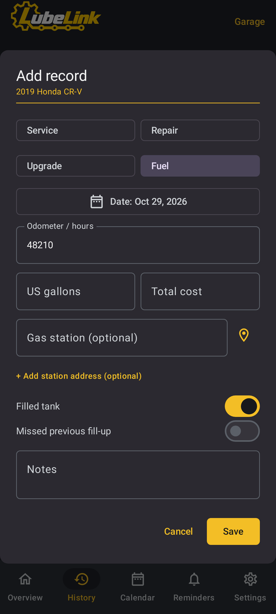
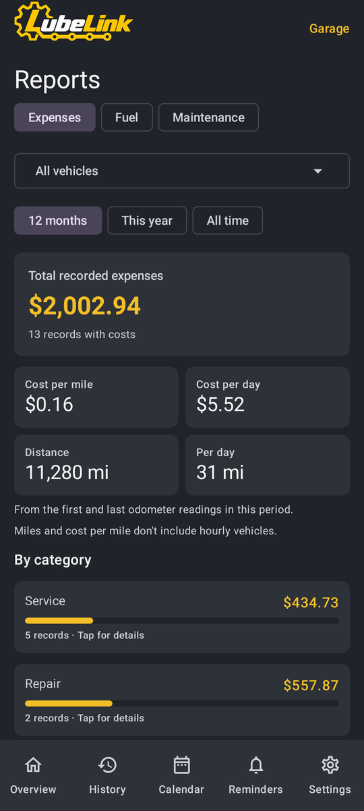
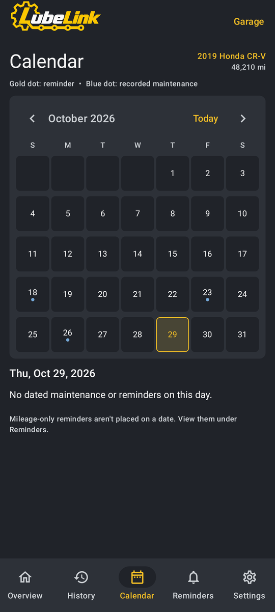

**Note:** First off, LubeLogger is fantastic. I built this solely because I missed the native app feel at the gas pump or after an oil change. There are still some API limitations, mainly around reminders, that will hopefully be addressed soon. I'll update LubeLink to take advantage of those changes when they're available.

I've been using it for a while before making this repo public, but please be aware that I designed it for myself and my own use cases, so I know it won't meet everyone's needs or suit every vehicle.

Feel free to suggest ideas or request features. I'm not accepting PRs yet, and I'm intentionally not adding a license for now. I'm happy to share this, but it hasn't been tested long enough for me to feel comfortable letting it out of my hands yet.

---

<p align="center">
  
</p>

<p align="center">An Android app for your self-hosted <a href="https://github.com/hargata/lubelog">LubeLogger</a>.</p>

LubeLink puts your LubeLogger garage on your phone. See what maintenance is coming up, look back through a
vehicle's history, and log a fill-up or an oil change on the spot instead of later at a computer. Your records stay on
your own server: LubeLink reads and writes them through LubeLogger's API and keeps no records of its own.

LubeLink is an independent project and is not affiliated with LubeLogger.

<p align="center">
  &nbsp;
  &nbsp;
  
</p>
<p align="center">
  &nbsp;
  &nbsp;
  
</p>
<p align="center"><sub>Screenshots show a made-up garage and records.</sub></p>

## Features

- **Garage:** every vehicle with its odometer and maintenance alerts, as a grid or a list. Nicknames and hidden
  vehicles are kept on the phone.
- **History and Calendar:** service, repair, upgrade and fuel records grouped by month with totals, including
  attachments.
- **Add and edit records:** service, repair, upgrade and fuel, or start from a copy of an earlier record.
- **Gas stations:** pick a station from a map or a list of nearby ones, and keep favourites. Station names and
  addresses are saved with fuel records when LubeLogger has the two fields for them (see Setup).
- **Reports:** expenses, fuel and maintenance for one vehicle or the whole garage, with cost per mile and an odometer
  chart.
- **Reminders:** LubeLogger's reminders by urgency, with optional daily notifications on the phone.
- **Delete:** optional, with a separate Manager key and a confirmation.

Electric-vehicle charging records are shown but can't be added or edited in LubeLink, because LubeLogger's API does
not return the charging quantity. See [Known issues](docs/KNOWN-ISSUES.md) for the other limitations.

## Install

Download the APK from the [latest release](../../releases/latest) and open it on your phone. You may need to allow
installs from your browser or file manager. Android 11 or later is required.

Updates install over the previous version, keeping your settings, as long as both come from this repository's
releases.

## Setup

You need a LubeLogger server reachable over **HTTPS** with a certificate Android trusts (self-signed certificates are
not accepted). A server you reach over a VPN works while the VPN is connected.

1. In LubeLogger, create an API key with **Editor** permission.
2. Open LubeLink and enter your server's address (for example `https://lubelogger.example.com`) and the key.
3. Optional extras, all under Settings:
   - a **Manager** key, to delete records;
   - a [Geoapify](https://www.geoapify.com/) API key, for station search through Geoapify instead of the public
     Overpass (OpenStreetMap) servers;
   - saved gas stations: in LubeLogger, add two **Text** extra fields to Fuel records, named `LubeLink Gas Station` and
     `LubeLink Station Address`, then check them in LubeLink under Settings → Record Fields.

LubeLink is tested with LubeLogger 1.7.3 and 1.7.4.

## Privacy

LubeLink talks to your LubeLogger server over HTTPS. Your keys are stored on the phone, encrypted with an Android
Keystore key. LubeLogger keys are sent only to your server, and a Geoapify key only to Geoapify. Station search sends an approximate position (rounded to about 100 m)
to a public Overpass server, or to Geoapify if you saved a key. Map tiles come from OpenFreeMap for the area on
screen, and "use my location" for an address may use the phone's geocoding service. Reminder notifications are made
on the phone from your server's reminders. LubeLink has no analytics, ads or accounts of its own.

Every network call the app can make is listed in [docs/API-CONTRACT.md](docs/API-CONTRACT.md).

## Good to know

- LubeLogger stays the system of record. Changes and deletes made in LubeLink happen on your server, so keep server
  backups.
- If a save's reply is lost on the way back (a dropped connection, a timeout or a server error), LubeLink never sends it
  again on its own. It asks you to check the record in LubeLogger first.
- App settings are not included in Android backups. On a new phone, connect again and set your preferences.

## Building from source

Requirements: JDK 21 and the Android SDK 36 (Android Studio works).

```sh
./gradlew :app:assembleDebug                        # gradlew.bat on Windows
./gradlew :app:testDebugUnitTest :app:lintDebug
```

The debug build is "LubeLink Review" (`com.kramttocs.lubelink.review`), so it installs beside the release app.

More checks, all with synthetic data:

- `./scripts/run-offline-tests.sh` and `./scripts/run-network-tests.sh` need `kotlinc` 2.1.20 and JDK 17 or later.
- `./scripts/run-integration-tests.sh` also needs Docker: it starts a disposable LubeLogger 1.7.4 and runs the app's
  clients against it.
- `./gradlew :app:connectedDebugAndroidTest` installs and removes packages on every connected device, so it refuses to
  run unless exactly one running emulator is connected. Use a disposable one.

Never point tests at a real server. A signed release build reads its key from `LUBELINK_RELEASE_*` environment
variables; no key, password or server address is in this repository.

## Documents

- [docs/API-CONTRACT.md](docs/API-CONTRACT.md): every call LubeLink makes.
- [docs/DECISIONS.md](docs/DECISIONS.md): the product decisions the code refers to as `OD-nn`.
- [docs/KNOWN-ISSUES.md](docs/KNOWN-ISSUES.md): known limitations.

LubeLink is a personal project, shared as is, with no support commitment or compatibility guarantee.
